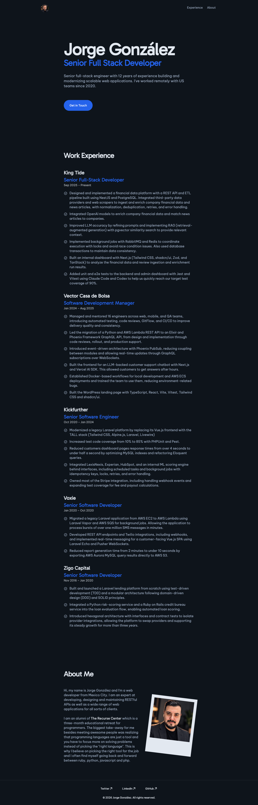
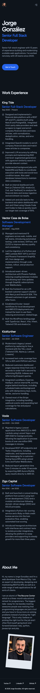

# Done

The site at `/` now matches https://astro-zen.vercel.app/ apart from the intended content
changes and the hidden Featured Projects section (see BLOCKERS.md).

## Final screenshots

| 1440px | 390px |
| --- | --- |
|  |  |

## Stop conditions

**All 7 content changes are verified in the rendered page** (Playwright DOM checks at 1440px and 390px):

1. "Jorge González" in the `h1`, `<title>`, `author`, `og:title` and `twitter:title`. No
   "Alejandro" or "Múnez" anywhere in the HTML.
2. Subtitle "Senior Full Stack Developer".
3. "Get in Touch" links to `mailto:jorgegonzalez.dev@gmail.com`.
4. Five roles (King Tide, Vector Casa de Bolsa, Kickfurther, Voxie, Zigo Capital) with titles,
   dates and all 23 bullets. Each was matched verbatim and in order against text extracted
   from `Jorge-Gonzalez.pdf`. The check-icon bullets render.
5. `assets/images/profile.png` (a copy of your photo) is used for the nav avatar and the
   polaroid. Both load from the site's own origin. The polaroid is tilted 7deg at ≥768px and
   5deg below that, like the reference.
6. Footer links are Twitter, LinkedIn and GitHub, in that order, with the given URLs. No
   YouTube or Dribbble.
7. The footer text is "© 2026 Jorge González. All rights reserved."

Also checked: none of the reference's placeholder content appears (San Francisco, Spotify,
Shopify, Instagram clones, its companies, its credits).

**Only content differences remain at both viewports.** The computed-style diff against the
reference is empty for every styled element, except for:
- geometry driven by content (longer text, fewer nav and footer links)
- `object-fit: cover` on the avatar, which your non-square photo needs
- the About padding sitting on a wrapper instead of the `<p>`, which gives an identical box

Interaction states also match: nav hover, footer hover, the active-section dot, the
scroll-linked header slide and the mobile menu.

**The build passes and the console is clean.** There are 0 console errors or warnings, 0 failed
requests and 0 broken images at both viewports.

**A clean production build is static only.** `rm -rf _site && JEKYLL_ENV=production jekyll build`
outputs `index.html`, `style.css`, 3 images and the favicon, and nothing else. Served with
`python3 -m http.server` (not a dev server), it passes every check at `/`, the real base path
for this user site. A build with `--baseurl /scrubmx.github.io` also passes, so the paths are
base-aware.

## How to build locally

The system Ruby (rvm 2.6) is broken, so builds run in Docker:

```bash
docker run --rm -v "$PWD":/srv -v jekyll-gems:/usr/local/bundle -w /srv ruby:3.3 sh -c "bundle install && bundle exec jekyll build"
```

## To go live

Merge `redesign` into `master` and push. Then set **Settings → Pages → Source** to **GitHub Actions**.
